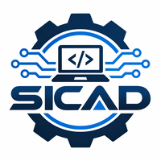

# SICAD - Sistema de Control de Asistencia

## Descripción del proyecto

**SICAD** es un sistema de control de asistencia desarrollado como proyecto de software. Su propósito es facilitar el registro y seguimiento de la asistencia, permitiendo organizar la información de manera sencilla y eficiente.

El sistema busca mejorar el proceso de control de asistencia mediante una herramienta digital que permita consultar y administrar los registros.

## Objetivo

Desarrollar un sistema que permita llevar un control organizado de la asistencia, facilitando el registro de información y reduciendo el trabajo manual.

## Características principales

- Registro de asistencia.
- Administración de información.
- Consulta de registros.
- Organización de datos.
- Interfaz para facilitar el uso del sistema.

## Tecnologías utilizadas

- **HTML:** Para la estructura de las páginas.
- **CSS:** Para el diseño de la interfaz.
- **JavaScript:** Para agregar funcionalidades.

## Instalación y uso

Para utilizar el proyecto se deben seguir los siguientes pasos:

1. Descargar o clonar el repositorio del proyecto SICAD.
2. Abrir la carpeta del proyecto en Visual Studio Code.
3. Revisar que todos los archivos necesarios se encuentren dentro de la carpeta.
4. Abrir el archivo principal del sistema.
5. Ejecutar el proyecto desde el navegador o mediante el servidor configurado.
6. Comenzar a utilizar las funciones disponibles del sistema.

## Importancia del proyecto

*El proyecto SICAD busca facilitar el control de asistencia mediante el
 uso de herramientas tecnológicas, mejorando la organización y consulta de 
 los registros..*

## Imagen del proyecto

